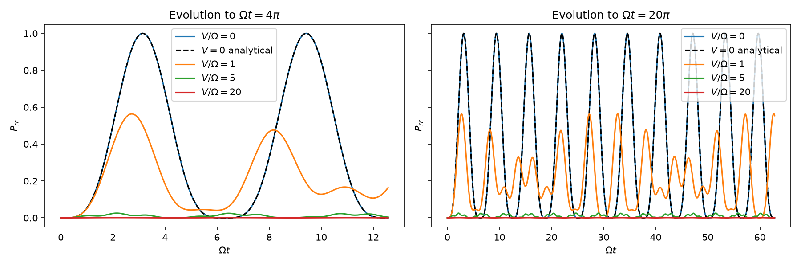
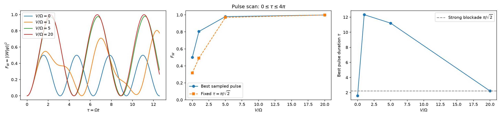
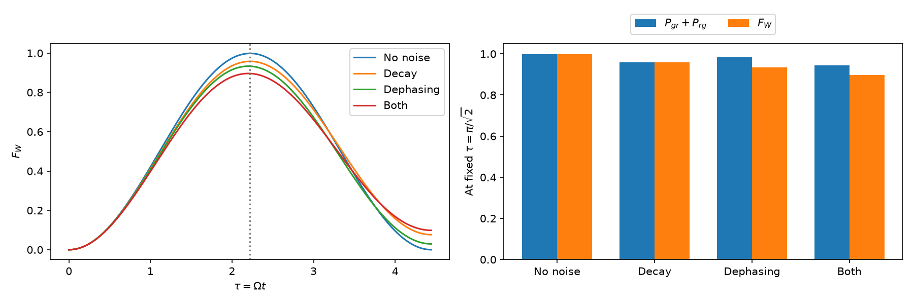
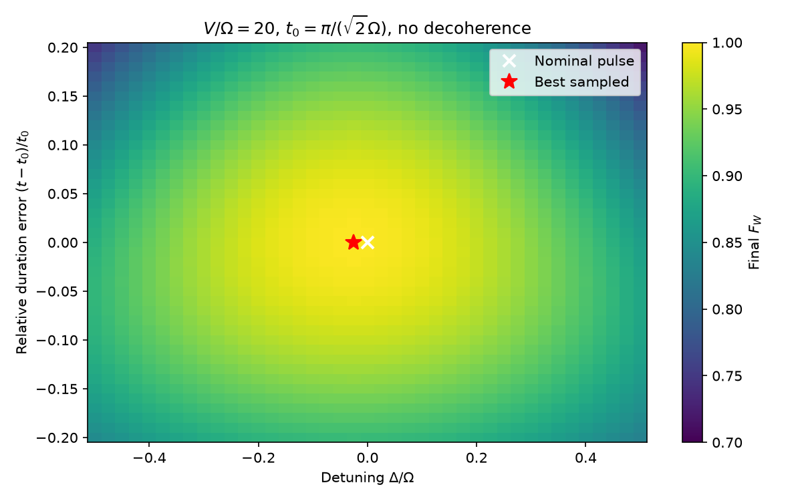

Two laser-driven atoms start in $|gg\rangle$. The drive has $\Omega=1$; time is $\tau=\Omega t$. The target is $|W\rangle=(|gr\rangle+|rg\rangle)/\sqrt{2}$. All results are numerical.

Raising $V/\Omega$ from 0 to 20 cuts peak double excitation $P_{rr}$ from 1.000 to 0.001. At $V=0$, the numerical trace follows $\sin^4(\tau/2)$; the largest error over $0\leq\tau\leq20\pi$ is $1.51\times10^{-5}$.

The pulse scan covers $0\leq\tau\leq4\pi$. At $V/\Omega=20$, its best sampled duration is $\tau=2.2219$, with $F_W=0.9985$. Strong blockade predicts $\pi/\sqrt{2}=2.2214$. Without interaction, fidelity peaks at 0.5000.

Noise lowers fidelity at the fixed pulse $\tau=\pi/\sqrt{2}$ and $V/\Omega=20$: 0.9985 with no noise, 0.9580 for $\Gamma/\Omega=0.05$, 0.9333 for $\gamma_\phi/\Omega=0.05$, and 0.8961 with both. Under dephasing alone, the singly excited population is 0.9843. Lost coherence between $|gr\rangle$ and $|rg\rangle$ accounts for the lower fidelity.

The $V/\Omega=20$ laser scan covers detuning from $-0.5$ to $+0.5$ and timing errors of $\pm20\%$. At $\Delta/\Omega=+0.5$, fidelity falls from 0.9985 to 0.8678. A 20% longer pulse at zero detuning gives 0.9036; combining both errors gives 0.7189. Detuning has the larger effect over these ranges.

